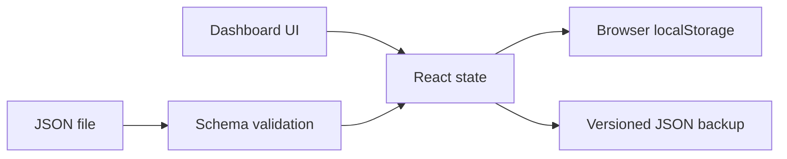

# Kiến trúc

## Hiện trạng package

- Next.js App Router 15 + React 19 + TypeScript.
- Route entries giữ mỏng ở `app/page.tsx` và `app/tasks/page.tsx`; workspace UI nằm trong `app/_components/workspace/`.
- Layout cross-route nằm trong `app/_components/layout/`; `app/layout.tsx`, `app/loading.tsx`, `app/error.tsx` và `app/manifest.ts` chỉ là thin entries cho App Router.
- `Board.tsx` điều phối state/view; `TaskModal.tsx` phụ trách CRUD form; `NotificationPopover.tsx` phụ trách notification UI. CSS dùng chung ở `app/globals.css`.
- `lib/data.ts` giữ demo seed và adapter localStorage.
- `lib/types.ts` là hợp đồng dữ liệu.
- `supabase/schema.sql` là schema mục tiêu cho database.
- Workflow local-first hiện có seam cho Focus view, saved views, bulk update, undo snapshot và activity/next-action; các field mới vẫn optional để tương thích dữ liệu v1.

## Quy ước mở rộng UI

- Tab hoặc view mới đặt dưới `app/_components/<feature>/`, không thêm component lớn vào route entry.
- Route page chỉ import feature root và giữ URL hiện tại (`/`, `/tasks`).
- Logic dữ liệu dùng chung đặt trong `lib/`; không đọc/ghi localStorage trực tiếp trong nhiều component nếu có thể gom qua adapter.
- Khi feature đủ lớn, tách tiếp `hooks/`, `components/`, `validators/` trong feature folder trước khi mở thêm tab.

## Luồng hiện tại

MVP hiện tại là local-first. Mỗi trình duyệt/máy có vùng lưu riêng. Export/import là cách di chuyển dữ liệu. Supabase schema đã có contract single-account với `owner_id = auth.uid()` và RLS; adapter CRUD chưa nối vào giao diện. Local mode không cần credentials.

## Mô hình dữ liệu

- `members`: id, name, role, color, active.
- `tasks`: id, code, title, description, status, priority, severity, next action, review note, dependency IDs, activity summary, primary/secondary links, legacy `assignee_id`, dev_up, staging_up, release_at, deadline, order_index, links, timestamps.
- `task_assignees`: bảng nối nhiều-nhiều giữa task và member; đây là nguồn quan hệ assignment chuẩn cho task có một hoặc nhiều người phụ trách.
- `BoardData` also stores `code_prefix` and `sort_mode`; manual drag order therefore survives refresh and JSON import/export.
- Priority diễn đạt thứ tự xử lý. Severity biểu thị mức ảnh hưởng/rủi ro. Hai thuộc tính không thay thế nhau.

## Quy ước thời gian

Ngày do người dùng nhập là ngày lịch; hiện MVP chuyển thành UTC ISO timestamp để tương thích DB. Khi có timezone-aware backend, nên lưu date-only (`date`) cho ngày phát hành/deadline nếu không cần giờ chính xác. Múi giờ hiển thị theo trình duyệt.

## Mở rộng Supabase

1. Bật Supabase Auth cho account deploy duy nhất và session server-side.
2. Chạy schema, kiểm tra RLS bằng request authenticated và anonymous.
3. Tạo `lib/repositories/task-repository.ts` với adapter local và Supabase.
4. Thêm migration cho owner_id, domain fields mới, file metadata, notification settings.
5. Xử lý optimistic update và lỗi đồng bộ; không báo “đã lưu” nếu remote write thất bại.
6. Với uploads, Storage policy phải cùng quyền truy cập bảng task.

## Notification

Dashboard hiện tính mốc gần trực tiếp từ task. Push/message định kỳ phải chạy server-side qua scheduled function, dùng idempotency key theo task + loại mốc + ngày, ghi lịch sử gửi để tránh trùng. Chatwork API token chỉ nằm ở server secrets.
