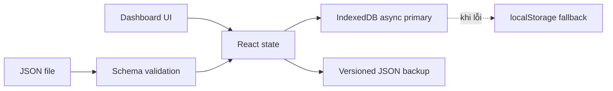

# Kiến trúc

Typography dùng Geist Sans self-host với Latin và Latin Extended subsets; giao diện không gọi dịch vụ font bên ngoài khi người dùng mở app. `WorkspaceShell` là route entry nhẹ, hiển thị loading shell có cấu trúc và tải `WorkspaceCoordinator` bằng dynamic import. Coordinator giữ state và domain mutations; task modal, settings/dialogs, Kanban, timeline, dashboard analytics và notification popover vẫn được tách theo nhu cầu.

Task details tách activity history và comments panel khỏi `TaskModal`; panel comments tự quản lý composer/reply state, còn mutation callback giữ đồng bộ form và workspace state.

Các view/dialog ít dùng được tải bằng dynamic import để giảm JavaScript ban đầu. `WorkspaceOverview` chỉ tải ở route tổng quan; Timeline, Kanban, modal và dialog vẫn lazy-load theo nhu cầu. Saved views và phím tắt nằm trong hook riêng. Font public có content hash và cache immutable; dữ liệu task/workspace không cache phía server vì thay đổi theo thiết bị/tài khoản. Search compile điều kiện một lần cho query hiện tại rồi lọc task; selector và biểu đồ dùng memoization.

## Hiện trạng package

- Next.js App Router 15 + React 19 + TypeScript.
- Route entries giữ mỏng ở `app/page.tsx` và `app/tasks/page.tsx`; workspace UI nằm trong `app/_components/workspace/`.
- Layout cross-route nằm trong `app/_components/layout/`; `app/layout.tsx`, `app/loading.tsx`, `app/error.tsx` và `app/manifest.ts` chỉ là thin entries cho App Router.
- Các route workspace dùng `WorkspaceShell.tsx` làm entry point và defer `WorkspaceCoordinator.tsx` khỏi bundle khởi tạo. Coordinator điều phối state/view; dashboard analytics, saved views, shortcuts, backup restore và push delivery đã tách module/hook riêng. `TaskModal.tsx` phụ trách CRUD form và giới hạn dependency candidates theo search; `WorkspaceDialogs.tsx` giữ settings/confirm/lock dialog; `NotificationPopover.tsx` phụ trách notification UI. Design tokens và component styles dùng chung ở `app/globals.css`.
- `lib/data.ts` giữ demo seed và adapter dữ liệu; persistence local ưu tiên IndexedDB, localStorage được giữ làm fallback/migration cho môi trường không hỗ trợ IndexedDB.
- `lib/types.ts` là hợp đồng dữ liệu.
- `lib/taskboard/constraints.ts` kiểm tra các quan hệ xuyên entity (assignee, dependency, activity) sau khi từng entity đã hợp lệ.
- `lib/taskboard/permissions.ts` tách quyền workspace (`owner/admin/member/viewer`) khỏi chức danh công việc của member.
- `lib/taskboard/remote-sync-queue.ts` giữ remote task mutation khi offline/lỗi mạng, scope theo account + workspace, dedupe theo task và retry exponential backoff; conflict revision được pause để tránh retry vô hạn và tự mở lại khi có task version mới.
- `lib/taskboard/dates.ts` là seam dùng chung cho input ngày giữa Board và TaskModal; TaskModal được lazy-load vì không cần cho initial render.
- `lib/taskboard/backup.ts` chuẩn hóa JSON backup legacy/current và khôi phục snapshot undo; `lib/taskboard/web-push-delivery.ts` tách kiểm tra cấu hình, dedupe state và delivery adapter để test không cần gọi push provider thật.
- `lib/taskboard/search.ts` cung cấp `createTaskSearchMatcher`; Board tạo matcher một lần theo deferred query thay vì parse lặp cho mỗi task.
- Mỗi Kanban column dùng một `IntersectionObserver` chung để mount card trong overscan; đổi index về đầu danh sách sau khi lọc sẽ mount lại kết quả mới.
- `lib/i18n/index.ts` là seam locale chung: locale hợp lệ, nhãn lựa chọn, Intl mapping, catalog copy và persistence key. Domain data vẫn lưu enum ổn định, không lưu text đã dịch.
- `supabase/schema.sql` là schema mục tiêu cho database.
- Workflow local-first hiện có seam cho Focus view, saved views, bulk update, undo snapshot và activity/next-action; các field mới vẫn optional để tương thích dữ liệu v1.

## Quy ước mở rộng UI

- Tab hoặc view mới đặt dưới `app/_components/<feature>/`, không thêm component lớn vào route entry.
- Route page chỉ import feature root và giữ URL hiện tại (`/`, `/tasks`).
- Logic dữ liệu dùng chung đặt trong `lib/`; không đọc/ghi localStorage trực tiếp trong nhiều component nếu có thể gom qua adapter.
- Khi feature đủ lớn, tách tiếp `hooks/`, `components/`, `validators/` trong feature folder trước khi mở thêm tab.

## Invariants và error boundary

- ID của member/task là duy nhất trong workspace.
- Assignee phải trỏ tới member tồn tại, không lặp và `assignee_id` legacy phải nhất quán với phần tử đầu của `assignee_ids`.
- Dependency phải trỏ tới task tồn tại, không tự trỏ, không lặp và không tạo cycle.
- Activity ID không lặp trong cùng task; schema version chỉ chấp nhận version được hỗ trợ.
- Local storage hỏng hoặc không hợp lệ không bị im lặng thay bằng dữ liệu mẫu: adapter trả lỗi để UI thông báo rõ và người dùng có cơ hội export/khôi phục.

Validation shape nằm ở `lib/data.ts`; validation relation nằm ở `lib/taskboard/constraints.ts`. Hai lớp này là cùng một seam import/remote/local, nên không được bypass khi thêm adapter mới.

## Performance budget hiện tại

- Build production lần rà soát 2026-11-25 tạo First Load JS khoảng 203 kB cho các route workspace (`/`, `/tasks`, `/today`, `/inbox`, `/timeline`). Mốc trước đợt tối ưu gần nhất là 208 kB; con số phụ thuộc phiên bản dependency và cần cập nhật sau build có thay đổi bundle.
- Task modal được tải theo nhu cầu bằng dynamic import để initial render không phải tải form CRUD và attachment controls.
- Settings/confirm/lock dialog cũng được tải theo nhu cầu; route metadata có title, description và canonical riêng cho `/tasks`, `/today`, `/login`.
- Geist Sans được self-host với Latin/Latin Extended; file font có content hash và cache `public, max-age=31536000, immutable`. CSS vẫn có system fallback để xử lý khi font tải lỗi.
- View Kanban, timeline, TaskCard và một số popover/dialog được tách dynamic chunk. Dữ liệu workspace cá nhân không dùng cache HTTP dùng chung.
- Ghi workspace ưu tiên IndexedDB bất đồng bộ; chỉ ghi localStorage khi IndexedDB thất bại. localStorage vẫn được đọc để migrate/khôi phục fallback. Daily backup lưu tối đa 7 bản/workspace.
- Locale hiện có `vi`, `en`, `ja`; language setting đã lưu lựa chọn, đổi `html lang` và định dạng ngày/giờ. Copy toàn bộ màn hình sẽ được migrate qua catalog theo từng feature, không dịch trực tiếp trong domain logic.
- Search dùng `useDeferredValue`; query conditions được parse trong `lib/taskboard/search.ts`, derived task lists dùng `useMemo`. Mỗi Kanban column dùng lazy/windowed card rendering với overscan 720px, placeholder intrinsic size và `content-visibility: auto`; card height biến thiên vẫn cần benchmark trên dataset cực lớn.

## Luồng hiện tại

MVP hiện tại là local-first. Mỗi trình duyệt/máy có vùng lưu riêng. Export/import là cách di chuyển dữ liệu. Supabase schema có legacy snapshot `owner_id` và contract multi-workspace mới qua `workspaces`, `workspace_members`, `workspace_snapshots`, `workspace_id` và RLS role-aware. Cloud mode hỗ trợ catalog workspace, load snapshot theo workspace, remote CRUD từng task, optimistic revision check, realtime subscription, offline queue và Conflict Center; legacy snapshot vẫn là fallback. Local mode không cần credentials.

## Mô hình dữ liệu

- `members`: id, name, role, color, active.
- `tasks`: id, code, title, description, status (`todo`, `in_progress`, `review`, `blocked`, `done`), optional `blocked_from`, priority, severity, next action, review note, dependency IDs, checklist, inbox/triage state, snooze window, activity diff, primary/secondary links, legacy `assignee_id`, dev_up, staging_up, release_at, deadline, order_index, links, attachments, timestamps.
- `task_assignees`: bảng nối nhiều-nhiều giữa task và member; đây là nguồn quan hệ assignment chuẩn cho task có một hoặc nhiều người phụ trách.
- `workspaces` và `workspace_members`: multi-workspace và role (`owner`, `admin`, `member`, `viewer`); local UI vẫn giữ backward compatibility với workspace mặc định, còn cloud user có thể tải/tạo workspace remote. `viewer` được đưa vào Board read-only và không thể mutate task/member data.
- Các query task/member theo workspace có index `workspace_id`; task list cloud có thêm composite index `(workspace_id, order_index)` để giữ thứ tự ổn định khi workspace lớn.
- Settings cloud có thể invite bằng email qua server route, list/update/remove member theo Supabase user ID; owner membership và owner role được bảo vệ bởi trigger. Service role chỉ được đọc ở server, không được giả lập hoặc expose ở client.
- Attachment path dùng workspace UUID cho cloud workspace, Storage policy áp theo workspace role, và signed URL được refresh khi mở task để không giữ URL hết hạn trong UI.
- `BoardData` also stores `code_prefix` and `sort_mode`; manual drag order therefore survives refresh and JSON import/export.
- Priority diễn đạt thứ tự xử lý. Severity biểu thị mức ảnh hưởng/rủi ro. Hai thuộc tính không thay thế nhau.

## Quy ước thời gian

Ngày do người dùng nhập là ngày lịch; hiện MVP chuyển thành UTC ISO timestamp để tương thích DB. Khi có timezone-aware backend, nên lưu date-only (`date`) cho ngày phát hành/deadline nếu không cần giờ chính xác. Múi giờ hiển thị theo trình duyệt.

## Mở rộng Supabase

1. Bật Supabase Auth và cấu hình redirect URL cho môi trường deploy.
2. Chạy schema, kiểm tra RLS bằng owner/member/viewer và request anonymous.
3. Dùng repository cloud qua Auth; mutation task dùng conditional write theo `updated_at`, offline queue và Conflict Center.
4. Chạy `npm run test:supabase:required` trên project test trước khi bật cloud cho dữ liệu thật.
5. Với uploads, Storage bucket phải private, giới hạn MIME/size và policy phải khớp quyền workspace.

## Notification

Browser notification cục bộ là per-device, yêu cầu tab mở. Web Push nền dùng Service Worker và Supabase `push_subscriptions`, chỉ gửi cho owner cloud qua `/api/notifications/push`. Daily Chatwork digest chạy qua `/api/notifications`; hai route dùng cron secret và run idempotency theo owner + ngày + channel. VAPID private key và Chatwork token chỉ ở server; Gmail chưa được tích hợp.
